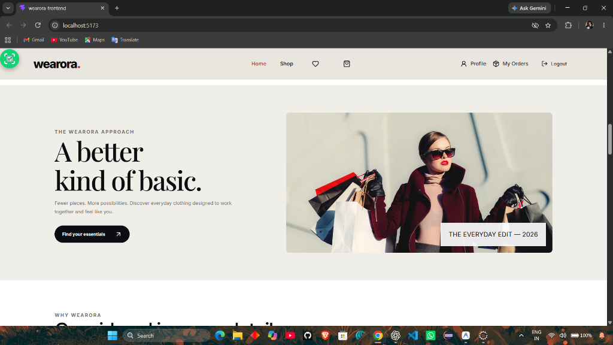
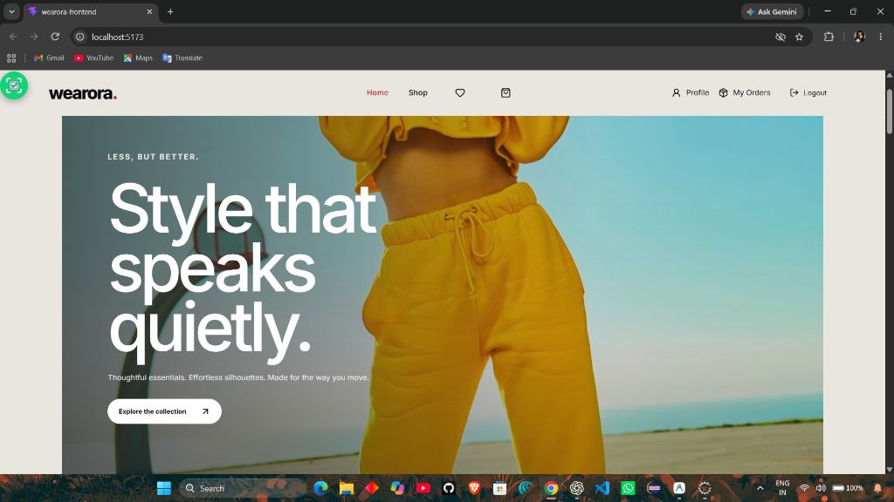
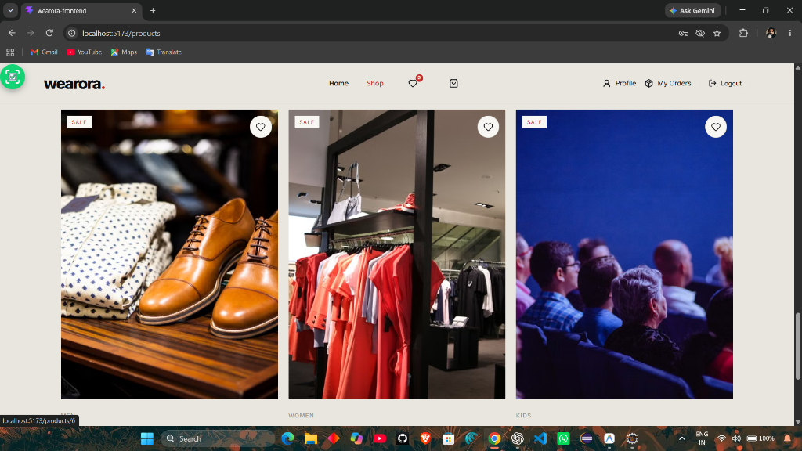
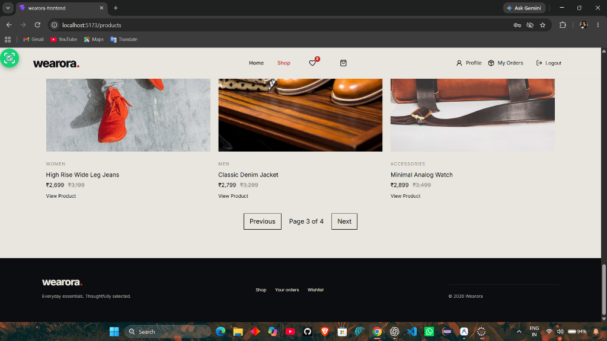
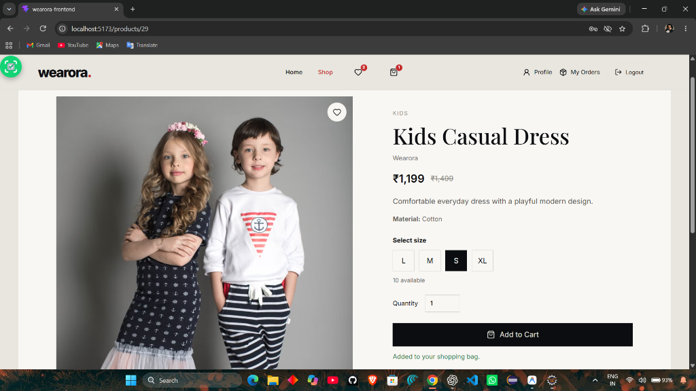

# Wearora — Full-Stack E-Commerce Web Application

[](https://www.oracle.com/java/)
[](https://spring.io/projects/spring-boot)
[](https://spring.io/projects/spring-security)
[](https://www.mysql.com/)
[](https://react.dev/)
[](https://vitejs.dev/)

> A decoupled, production-grade e-commerce web application engineered with **Spring Boot REST APIs**, **Spring Security with JWT**, **Spring Data JPA**, **MySQL**, and a modern **React (Vite)** frontend. Built with enterprise considerations including **server-side price validation**, **transactional checkout**, and **pessimistic row locking** to prevent overselling under concurrent load.

---

## 📸 Application Screenshots

### Hero & Featured Collections

*Curated lifestyle homepage with responsive navigation, user profile status, and collections callout.*


*Seasonal curated hero showcase with active theme integration.*

---

### Product Discovery & Catalog

*Paginated product discovery grid with category tags, sale indicators, wishlist toggles, and live pricing.*


*Server-side paginated catalog browsing with instant responsive rendering.*

---

### Product Details & Variant Selection

*Interactive product view with real-time stock availability, size variant selectors (`S`, `M`, `L`, `XL`), quantity controls, and cart integration.*

---

## 🎯 Key Technical Highlights & Architecture

- **Stateless Authentication with JWT**: Token-based security via `JwtAuthenticationFilter` and `JwtService`, separating `ROLE_CUSTOMER` and `ROLE_ADMIN` permissions.
- **Untrusted Client Security (Server-Side Pricing)**: Checkout amounts are calculated exclusively on the server from authoritative product prices, completely ignoring client-submitted price inputs.
- **Concurrency & Stock Protection (Pessimistic Locking)**: Transactional checkout locks variant rows in predictable sorted order (`SELECT ... FOR UPDATE`) to verify stock and decrement inventory safely, mitigating race conditions, overselling, and cross-cart deadlocks.
- **Duplicate Stock Restoration Safeguards**: Order cancellation acquires an exclusive lock on the customer's order record, checking state idempotency (`CANCELLED`) before restoring variant inventory.
- **Decoupled Architecture**: Clean separation between the Spring Boot API backend (`/api/*`) and the React 19 frontend communicating via Axios with configured CORS origins.

---

## 🧱 Layered Architecture Overview

```
wearora-backend/
├── src/main/java/com/wearora/
│   ├── config/            # CORS and Spring Security configurations
│   ├── controller/        # REST Controllers (Auth, Product, Cart, Order, Address, Wishlist)
│   ├── dto/               # Clean Request/Response Data Transfer Objects
│   ├── entity/            # JPA Entities (User, Product, ProductVariant, Order, Cart, etc.)
│   ├── exception/         # Centralized GlobalExceptionHandler (@ControllerAdvice)
│   ├── repository/        # Spring Data JPA repositories with custom queries & locks
│   ├── security/          # JwtService, JwtAuthenticationFilter, BCrypt encoder
│   ├── service/           # Business logic, transactional boundaries & locking
│   └── specification/     # Dynamic JPA Criteria specifications for filtering
└── wearora-frontend/       # React 19 + Vite frontend client
```

---

## 🛠️ Tech Stack & Dependencies

### Backend
- **Language**: Java 21
- **Framework**: Spring Boot 3.x (Spring Web, Spring Security, Spring Data JPA, Spring Validation)
- **Database & Persistence**: MySQL 8.0, Hibernate ORM
- **Security**: JWT (`jjwt-api`, `jjwt-impl`, `jjwt-jackson`), BCrypt password hashing
- **Build Tool**: Apache Maven (`mvnw`)
- **Testing**: Spring Boot Test, H2 In-Memory Database (for automated test isolation), JUnit 5, Mockito

### Frontend
- **Library**: React 19
- **Tooling**: Vite, Axios, React Router DOM
- **Styling**: Modern CSS3 responsive layouts with theme tokens

---

## 📋 REST API Endpoints Summary

| Method | Endpoint | Access | Description |
|:---|:---|:---|:---|
| `POST` | `/api/auth/register` | Public | Register new customer account |
| `POST` | `/api/auth/login` | Public | Authenticate and receive signed JWT |
| `GET` | `/api/products` | Public | Paginated product browsing with filters |
| `GET` | `/api/products/{id}` | Public | Fetch product details & size variants |
| `POST` | `/api/products` | Admin | Create product listing (`ROLE_ADMIN`) |
| `GET` | `/api/cart` | Customer | Get authenticated user's cart |
| `POST` | `/api/cart/items` | Customer | Add variant item to cart |
| `PUT` | `/api/cart/items/{id}` | Customer | Update cart item quantity |
| `DELETE` | `/api/cart/items/{id}` | Customer | Remove item from cart |
| `GET` | `/api/wishlist` | Customer | View wishlist items |
| `POST` | `/api/wishlist/{productId}` | Customer | Toggle product in wishlist |
| `GET` | `/api/addresses` | Customer | Manage delivery addresses |
| `POST` | `/api/orders/checkout` | Customer | Execute transactional checkout |
| `GET` | `/api/orders/my-orders` | Customer | View customer order history |
| `POST` | `/api/orders/{id}/cancel` | Customer | Cancel order with stock restoration |

---

## ⚙️ Prerequisites & Setup Instructions

### 1. Prerequisites
- **JDK 21** or higher installed (`java -version`)
- **MySQL 8.0** server running locally (`mysql -u root -p`)
- **Node.js 18+** & npm installed (`node -v`)

### 2. Database Configuration
Create the database in MySQL:
```sql
CREATE DATABASE wearora CHARACTER SET utf8mb4 COLLATE utf8mb4_unicode_ci;
```

Optionally apply the migration script located at `database/mysql/V20261012_01__add_user_role_and_prevent_negative_stock.sql`.

### 3. Backend Environment Configuration
Configure `src/main/resources/application.properties` or provide environment overrides:
```properties
spring.datasource.url=jdbc:mysql://localhost:3306/wearora
spring.datasource.username=YOUR_MYSQL_USERNAME
spring.datasource.password=YOUR_MYSQL_PASSWORD

spring.jpa.hibernate.ddl-auto=update
spring.jpa.show-sql=true

app.jwt.secret=m3Vesco7YLJxNLCa87u69nAzTx9S/jAWGsOmfHlqWa4=
app.jwt.expiration-ms=3600000

server.port=8080
```

Run the backend:
```bash
# On Windows
./mvnw.cmd spring-boot:run

# On Linux/macOS
./mvnw spring-boot:run
```
The REST API will start at `http://localhost:8080`.

### 4. Frontend Configuration & Execution
```bash
cd wearora-frontend
npm install
npm run dev
```
The React development server will start at `http://localhost:5173`.

---

## 🧪 Testing

Run backend unit and integration test suites:
```bash
./mvnw.cmd test
```
*Note: Backend tests execute against an isolated in-memory H2 database with MySQL compatibility mode enabled.*

---

## 📌 Known Limitations & Planned Enhancements
- [ ] Flyway versioned database migration integration across all environments.
- [ ] Concurrency load tests using MySQL Testcontainers.
- [ ] Online payment gateway integration (Stripe / Razorpay) beyond Cash on Delivery.
- [ ] Distributed caching using Redis for top-selling product categories.

---

## 👤 Author
- **Nezamul Haque**
- GitHub: [@Mudassir017](https://github.com/Mudassir017)
- LinkedIn: [nezamul-haque](https://www.linkedin.com/in/nezamul-haque)
- Portfolio: [nezamul-portfolio.vercel.app](https://nezamul-portfolio.vercel.app/)
